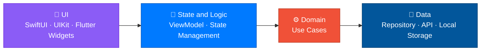

<div align="center">


<br/>


<br/>
<br/>

<a href="https://github.com/garvsharmxa">

</a>
&nbsp;
<a href="https://github.com/garvsharmxa?tab=followers">

</a>
&nbsp;
<a href="https://github.com/garvsharmxa">

</a>

<br/>
<br/>

**Crafting thoughtful mobile experiences with clean architecture, beautiful UI and production-grade engineering.**

</div>

---

## 👨‍💻 About Me

I'm a **mobile app developer** who builds production-ready apps for iPhone, with two tools I trust deeply:

* 🍎 **Swift + SwiftUI** for native iOS experiences that feel right at home on Apple devices
* 💙 **Flutter + Dart** for fast, beautiful, cross-platform delivery

I enjoy owning the whole mobile lifecycle, from the first sketch to the App Store release.

<div align="center">

 ➜
 ➜
 ➜
 ➜
 ➜
 ➜


</div>

---

## ⚔️ Two Stacks, One Goal

<div align="center">

<table>
<tr>

<td width="50%" align="center">

### 🍎 Native iOS


<br/>

`Swift` `SwiftUI` `UIKit`
`MVVM` `Clean Architecture`
`Core Data / Persistence`
`Push Notifications`

</td>

<td width="50%" align="center">

### 💙 Flutter


<br/>

`Flutter` `Dart`
`Responsive UI` `State Management`
`Clean Architecture`
`Reusable Widgets`

</td>

</tr>
</table>

</div>

### 🤔 How I Choose

| | 🍎 Native iOS (Swift) | 💙 Cross-platform (Flutter) |
| --- | --- | --- |
| **Reach for it when** | The app needs deep Apple-platform polish and system integration | Speed, one codebase and consistent UI matter most |
| **UI layer** | SwiftUI · UIKit | Flutter widgets |
| **Language** | Swift | Dart |
| **Architecture** | MVVM · Clean Architecture | Clean Architecture · State Management |

---

## 🧬 Developer DNA

<table>
<tr>
<td width="50%">

```swift
struct GarvSharma: MobileEngineer {

    let native = ["Swift", "SwiftUI", "UIKit"]
    let architecture = ["MVVM", "Clean Architecture"]
    let ships = "to the App Store 🚀"

    func build(_ idea: Idea) -> App {
        idea
            .designed()
            .architected()
            .tested()
            .polished()
            .shipped()
    }
}
```

</td>
<td width="50%">

```dart
class GarvSharma extends MobileEngineer {

  final stack = ['Flutter', 'Dart'];
  final focus = ['Clean UI', 'State Management'];
  final philosophy =
      'Simple experiences for complex problems.';

  App build(Idea idea) => idea
      .design()
      .architect()
      .test()
      .polish()
      .ship();
}
```

</td>
</tr>
</table>

---

## 🧰 Tech Stack

<div align="center">


</div>

---

## 🚀 Featured Projects

<div align="center">

<table>
<tr>

<td width="50%">

### 💜 NuminX

**Crypto Investment Platform**

A mobile investment platform focused on crypto index products, portfolio management and investment workflows.

`Flutter` `Dart` `FinTech`

**Built around**

* 📊 Portfolio management
* 💰 SIP investments
* 💳 One-time investments
* 📈 Real-time market data
* 🔐 Secure authentication
* 🪪 KYC / AML workflows
* 💸 Payment integrations

</td>

<td width="50%" align="center">


</td>

</tr>

<tr>

<td width="50%" align="center">


</td>

<td width="50%">

### 🍔 XpressBites

**Smart Campus Food Platform**

A campus-focused food ordering ecosystem designed to reduce queues and simplify food takeaways.

`Flutter` `Dart` `FoodTech`

**Highlights**

* 🍔 Pre-ordering
* 🏪 Multiple vendors
* 📦 Order tracking
* 👨‍🍳 Vendor management
* 🎓 Student ecosystem
* 🔔 Notifications
* ⚡ Real-time updates

</td>

</tr>
</table>

</div>

---

## 📱 iOS Lab

> A collection of iOS experiments, production applications and UI explorations built with modern Apple technologies.

<div align="center">

<table>
<tr>

<td align="center" width="25%">


<br/>

**SwiftUI**

Modern UI

</td>

<td align="center" width="25%">


<br/>

**Architecture**

MVVM

</td>

<td align="center" width="25%">


<br/>

**Networking**

REST APIs

</td>

<td align="center" width="25%">


<br/>

**Production**

TestFlight

</td>

</tr>
</table>

</div>

---

## 🏗️ How I Architect Mobile Apps

I prefer architectures that are **modular, testable and easy to evolve**, whether the UI is SwiftUI or Flutter.



### 🔥 Architecture Goals

| Principle | Goal |
| --- | --- |
| 🧩 Modularity | Keep features isolated and maintainable |
| 🧪 Testability | Make business logic easy to test |
| ⚡ Performance | Keep interactions fast and efficient |
| 🔐 Security | Protect user data and sensitive flows |
| 📈 Scalability | Make applications easy to evolve |
| 🎨 UI Quality | Build polished and consistent interfaces |

---

## 🧠 Engineering Principles

<div align="center">

<table>
<tr>

<td align="center" width="33%">

### 🎯 Product First

Build for the **user**, not just the feature.

</td>

<td align="center" width="33%">

### 🧩 Simple Architecture

Keep complexity where it belongs.

</td>

<td align="center" width="33%">

### ⚡ Performance

Fast interactions.
Efficient rendering.

</td>

</tr>

<tr>

<td align="center">

### 🧪 Quality

Test critical flows before shipping.

</td>

<td align="center">

### 🎨 Pixel Perfect

Details matter, especially on mobile.

</td>

<td align="center">

### 🚀 Ship

A feature has no value
if it never ships.

</td>

</tr>

</table>

</div>

---

## 📊 GitHub Analytics

<div align="center">


<br/><br/>


<br/><br/>


</div>

---

## 🎯 Currently Exploring

<div align="center">


</div>

---

## 🌐 Let's Connect

<div align="center">

<a href="https://github.com/garvsharmxa">

</a>
<a href="https://www.linkedin.com/in/garvsharmxa">

</a>
<a href="https://www.instagram.com/garvsharmxa">

</a>
<a href="https://garvsharmxa.dev">

</a>

<br/>
<br/>

### 💜 Have a mobile app idea?

**Let's turn it into something people love to use.**

<a href="https://www.linkedin.com/in/garvsharmxa">

</a>

<br/>
<br/>

`Swift` · `SwiftUI` · `Flutter` · `Dart` · `iOS`

<br/>

*Designed with intention. Built with Swift & Flutter. Shipped with purpose.*


</div>
